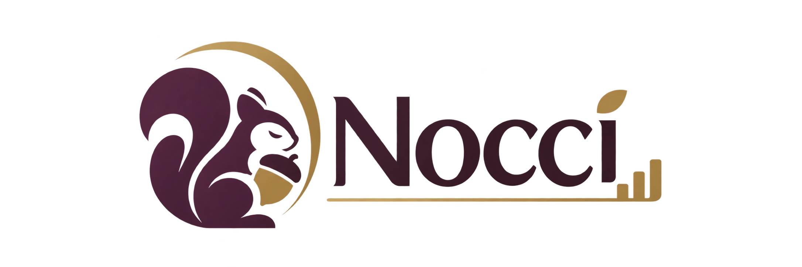

<p align="center">
  
</p>

# Nocci Financeiro

Sistema web de finanças pessoais criado como objeto de estudo do **Projeto Final de Verificação e Validação de Software** (Senac).

Módulos:

- **Calculadora de juros:** juros simples e compostos.
- **Simulador de empréstimo:** tabelas PRICE e SAC, com análise de crédito.
- **Controle de despesas:** registro de gastos, resumo mensal por categoria e alerta de orçamento.

A especificação completa está em [docs/requisitos.md](docs/requisitos.md).

## Como executar

Requer Python 3.10 ou superior.

```bash
python3 -m venv .venv
source .venv/bin/activate          # Windows: .venv\Scripts\activate
pip install -r requirements.txt
flask --app nocci.app run
```

Depois, abra http://127.0.0.1:5000 no navegador.

## API

Exemplo:

```bash
curl -X POST http://127.0.0.1:5000/api/juros \
  -H "Content-Type: application/json" \
  -d '{"tipo": "compostos", "capital": "1000", "taxa": "1", "periodos": 12}'
```

```json
{"tipo": "compostos", "capital": "1000", "taxa": "1", "periodos": 12, "juros": "126.83", "montante": "1126.83"}
```

As demais rotas estão listadas em [docs/requisitos.md](docs/requisitos.md#endpoints-da-api).

## Estrutura

```
nocci/
  app.py          # rotas web e API (Flask)
  juros.py        # RF01, RF02
  emprestimo.py   # RF03
  credito.py      # RF04
  despesas.py     # RF05, RF06, RF07
  validacao.py    # conversão e validação de entradas
  templates/      # páginas HTML
  static/         # CSS e logo
docs/
  requisitos.md   # especificação de requisitos
```
